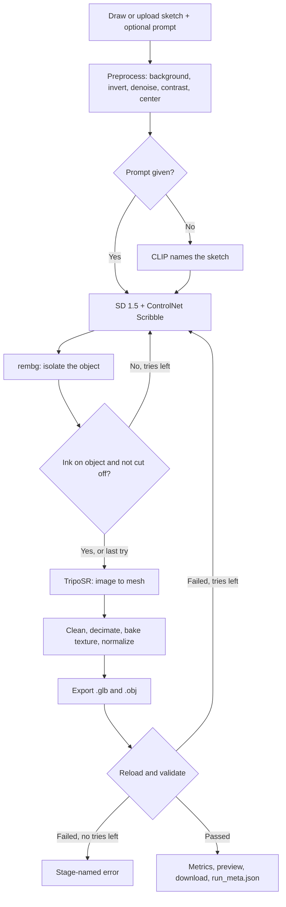

# Sketch2Shape

Turn a single hand-drawn sketch into a textured 3D model you can open in any 3D software. Draw in the app or upload an image. A text prompt is optional.

Built for TechZephyr 4.0, IIT Bhubaneswar. Models, libraries and AI-assistant use are disclosed in [ATTRIBUTION.md](ATTRIBUTION.md). The project report is `REPORT.md`.

## How it works



## Requirements

| | Tested | Notes |
|---|---|---|
| OS | Windows 11 25H2 | Linux on Colab/Kaggle is the documented remote path; see "Remote GPU" |
| Python | 3.11.9 | Pins were made on 3.11 |
| GPU | AMD Radeon RX 9070 XT, 16 GB, ROCm for Windows | Peak use 2.68 GB VRAM. NVIDIA should work but has not been run |
| RAM | 14.9 GB | Peak use 6.4 GB |
| Disk | About 15 GB free | Measured: 5.1 GB of libraries and 4.8 GB of weights, plus run outputs |
| Internet | First setup | See "Limitations" for running offline |

**Backends** (`runtime.backend` labels the run; the device is detected automatically)

| Backend | Runs on | Status |
|---|---|---|
| `local` | AMD ROCm, NVIDIA CUDA, Apple MPS, DirectML or CPU, tried in that order of config | AMD ROCm tested end to end. CPU started but not run to the end. Others not run |
| `remote_gpu` | Colab or Kaggle, through `notebooks/remote_gpu.ipynb` | Written. **Not run yet** |

## Install (Windows, AMD GPU)

Run these in PowerShell from the repository folder.

1. Create the environment with Python 3.11.

```powershell
py -3.11 -m venv .venv
```

2. Activate it.

```powershell
.venv\Scripts\Activate.ps1
```

3. Install PyTorch for your GPU. `requirements-rocm.txt` is for the RX 9070 XT family (`gfx1201`). Other AMD cards need a different `device-gfx` extra in that file.

```powershell
python -m pip install -r requirements-rocm.txt
```

4. Install everything else.

```powershell
python -m pip install -r requirements.txt
```

5. Download the weights and TripoSR source (about 5 GB). Re-running resumes.

```powershell
python scripts/download_weights.py
```

6. Put the source folder on the path for the hardware check. `app.py` and `cli.py` don't need this.

```powershell
$env:PYTHONPATH = "src"
```

7. Check the hardware report. `torch_gpu_name` should name your GPU.

```powershell
python -m sketch2shape.device
```

A clean install took about 14 minutes here, including one test run. Most of that is downloading: about 5 GB for libraries and about 5 GB for weights.

**Other hardware:** for NVIDIA or CPU, replace step 3 with the PyTorch install command for your system from https://pytorch.org/get-started/locally/. The rest is the same.

## Remote GPU (Colab or Kaggle)

1. Open `notebooks/remote_gpu.ipynb` in Colab and choose a GPU runtime.
2. In the first code cell, set `REPO_URL` to this repository.
3. Run all cells. The last cell prints a public Gradio link.

This path has not been run yet. Library pins came from Windows and Python 3.11, so they may need changes there. Texture baking needs an OpenGL context; if there is none, runs keep vertex colors and say so in `notes`.

## Run

**App:**

```powershell
python app.py
```

Open http://127.0.0.1:7860 once the terminal prints the address. Startup took about 60 s here, and the page is blank until then.

1. On the **Draw** tab, click the **Brush** icon first, then draw. Or use the **Upload** tab.
2. Optionally type a prompt.
3. Press **Generate**.

**Terminal:**

```powershell
python cli.py --input my_sketch.png --prompt "a red chair" --set runtime.seed=7
```

The exit code is 0 on success and 1 on failure, with a stage-named error. Add `--variants` to generate several models, best first.

**Sketch match and variants**

- **Sketch match view:** every run draws your strokes over the model's front view. Green strokes are on the model, and red strokes missed it. The score above the preview is the share of strokes on the model.
- **Generate 3 variants:** makes 3 models with different seeds, about 2.5 minutes in total, and ranks them. Ranking uses warnings first, then sketch match, then silhouette IoU. Click a variant to view it. That also puts its seed in Advanced settings, so **Generate** starts from it, then retries with new seeds if that attempt fails a quality check.

The ranking measures how well strokes are followed, not how good the model looks, so check the variants yourself.

## Configuration

Everything tunable is in `config.yaml`. Later sources override earlier ones:

`config.yaml` → environment variable → `--set` flag

```powershell
$env:S2S_SKETCH_TO_IMAGE__STEPS = "30"
python cli.py --input my_sketch.png --set sketch_to_image.controlnet_scale=1.1
```

Unknown keys raise an error, so typos can't pass silently.

| Key | Default | Meaning |
|---|---|---|
| `runtime.backend` | `local` | Label for the run: `local` or `remote_gpu` |
| `runtime.device` | `auto` | `auto`, `cuda`, `directml`, `mps` or `cpu` |
| `runtime.gpu_index` | `auto` | `auto` picks the usable GPU with the most memory, or give a number |
| `runtime.device_priority` | `['cuda', 'mps', 'directml', 'cpu']` | Order tried when device is `auto` |
| `runtime.dtype` | `auto` | `auto`, `float16` or `float32` |
| `runtime.dtype_fp16_devices` | `['cuda']` | Devices that use float16 when dtype is `auto` |
| `runtime.unload_between_stages` | `True` | Free models after each stage to save memory |
| `runtime.cpu_offload` | `True` | Keep idle parts of SD in RAM on CUDA/ROCm |
| `runtime.attention_slicing` | `True` | Lower SD memory use, slightly slower |
| `runtime.seed` | `42` | Starting seed; same seed gives the same image |
| `runtime.bytes_per_gb` | `1073741824` | Unit for memory and disk reports |
| `paths.weights_dir` | `weights` | Model weights folder |
| `paths.outputs_dir` | `outputs` | Run output folder |
| `paths.third_party_dir` | `third_party` | Downloaded TripoSR source folder |
| `preprocess.size` | `512` | Size of the clean sketch and control map |
| `preprocess.work_size` | `1024` | Large uploads are reduced to this first |
| `preprocess.pad_ratio` | `0.15` | Margin around the sketch, so objects aren't cut off |
| `preprocess.dark_background_level` | `110` | Median border gray below this means light-on-dark, so invert |
| `preprocess.denoise_strength` | `7` | Noise removal strength |
| `preprocess.contrast_clip_limit` | `2.0` | CLAHE contrast limit |
| `preprocess.contrast_grid` | `8` | CLAHE grid size |
| `preprocess.binarize_block_size` | `31` | Adaptive threshold block size (odd) |
| `preprocess.binarize_c` | `10` | Adaptive threshold offset |
| `preprocess.ink_dark_level` | `110` | Gray below this always counts as ink; keeps thick strokes solid |
| `preprocess.min_component_area` | `12` | Marks smaller than this are removed as noise |
| `preprocess.resize_ink_level` | `32` | Gray kept as ink after resizing |
| `preprocess.control_line_width` | `3` | Line width in the control map |
| `preprocess.fill_close_kernel` | `9` | Gap closing before the silhouette is filled |
| `preprocess.min_ink_ratio` | `0.001` | Less ink than this means an empty sketch |
| `preprocess.max_ink_ratio` | `0.4` | More ink than this means not a line sketch |
| `preprocess.max_components` | `150` | More separate marks than this means noise or a photo |
| `sketch_to_image.base_weights` | `sd15` | Name in `weights` of the SD model |
| `sketch_to_image.controlnet_weights` | `sd15_scribble` | Name in `weights` of the ControlNet |
| `sketch_to_image.weights_variant` | `fp16` | Weight file variant |
| `sketch_to_image.auto_subject` | `True` | With no prompt, let CLIP name the sketch |
| `sketch_to_image.clip_weights` | `clip` | Name in `weights` of CLIP |
| `sketch_to_image.subject_template` | `a simple line drawing of {}` | Text CLIP compares against the sketch |
| `sketch_to_image.subject_min_confidence` | `0.2` | Below this, `default_subject` is used |
| `sketch_to_image.subject_labels` | `list of 45 items` | Objects CLIP can name |
| `sketch_to_image.scheduler` | `UniPCMultistepScheduler` | Diffusers scheduler class |
| `sketch_to_image.min_image_std` | `2.0` | Below this, the image counts as blank |
| `sketch_to_image.steps` | `25` | Diffusion steps |
| `sketch_to_image.guidance_scale` | `7.5` | How strongly the prompt guides the image |
| `sketch_to_image.controlnet_scale` | `1.0` | Sketch faithfulness |
| `sketch_to_image.prompt_template` | `see `config.yaml`` | Wraps the subject or prompt |
| `sketch_to_image.default_subject` | `a 3D object` | Subject when nothing else is available |
| `sketch_to_image.negative_prompt` | `see `config.yaml`` | What to avoid |
| `background.rembg_model` | `isnet-general-use` | Background removal model |
| `background.output_size` | `512` | Size of the foreground image |
| `background.foreground_ratio` | `0.85` | Object size within that image |
| `background.alpha_level` | `127` | Alpha above this counts as object |
| `background.min_component_ratio` | `0.01` | Pieces below this share of the largest are dropped |
| `background.min_coverage` | `0.01` | Less foreground than this means removal failed |
| `image_to_3d.primary` | `triposr` | Main 3D model |
| `image_to_3d.fallback` | `None` | Used if the primary fails; `null` for none |
| `image_to_3d.triposr.weights` | `triposr` | Name in `weights` |
| `image_to_3d.triposr.config_name` | `config.yaml` | Model config file |
| `image_to_3d.triposr.weight_name` | `model.ckpt` | Model weight file |
| `image_to_3d.triposr.background_gray` | `0.5` | Gray behind the object for the model |
| `image_to_3d.triposr.chunk_size` | `8192` | Lower uses less memory, slower |
| `image_to_3d.triposr.mc_resolution` | `256` | Mesh grid resolution |
| `image_to_3d.triposr.density_threshold` | `25.0` | Surface level in the model's density field |
| `image_to_3d.triposr.bake_texture` | `True` | Texture map if true, vertex colors if false |
| `image_to_3d.triposr.texture_resolution` | `1024` | Texture size in pixels |
| `image_to_3d.triposr.texture_padding` | `4` | Gap between texture islands |
| `image_to_3d.triposr.texture_bleed_px` | `8` | Color spread past island edges |
| `mesh_post.merge_digits` | `6` | Decimal digits when merging vertices |
| `mesh_post.degenerate_height` | `1e-08` | Thinner faces count as degenerate |
| `mesh_post.min_body_ratio` | `0.01` | Separate pieces below this share of the largest are floaters |
| `mesh_post.target_faces` | `100000` | Decimate to this many faces; 0 for off |
| `mesh_post.normalize_extent` | `1.0` | Size of the largest side |
| `mesh_post.axis_order` | `[1, 2, 0]` | Source axes for output x, y, z. Keep this a rotation |
| `export.formats` | `['glb', 'obj']` | `glb` and/or `obj` |
| `export.min_vertices` | `100` | Validation minimum |
| `export.min_faces` | `100` | Validation minimum |
| `export.min_axis_ratio` | `0.05` | Thinnest side / largest; below this counts as flat |
| `export.max_file_mb` | `200` | Validation maximum |
| `metrics.clip_weights` | `clip` | Name in `weights` of CLIP |
| `metrics.n_views` | `8` | Views rendered around the mesh |
| `metrics.camera_distance` | `1.9` | Render camera distance |
| `metrics.camera_fov_deg` | `40` | Render camera field of view |
| `metrics.render_size` | `512` | Render size in pixels |
| `metrics.render_ambient` | `0.35` | Minimum brightness in renders |
| `metrics.iou_size` | `256` | Size used to compare silhouettes |
| `metrics.iou_fit` | `0.9` | Shape size within that frame |
| `metrics.min_ink_coverage` | `0.7` | Retry below this share of strokes on the object |
| `metrics.ink_tolerance_px` | `15` | Distance allowed between stroke and object |
| `metrics.min_silhouette_iou` | `0.2` | Retry below this; catches a collapsed mesh |
| `metrics.max_clipped_ratio` | `0.02` | Retry when the object covers more of the image border |
| `metrics.match_view_size` | `512` | Sketch match image size |
| `metrics.match_color` | `[0, 200, 80]` | Strokes on the model |
| `metrics.miss_color` | `[230, 30, 30]` | Strokes that missed |
| `variants.count` | `3` | Models per variants run |
| `variants.seed_step` | `100` | Seed change per variant |
| `variants.max_attempts` | `1` | Tries per variant |
| `retry.max_attempts` | `3` | Tries per run |
| `retry.seed_step` | `1` | Seed change per retry |
| `retry.scale_step` | `0.1` | ControlNet scale change per retry |
| `retry.keep_attempts` | `False` | Keep rejected attempts' files |
| `third_party.triposr.repo_url` | `see `config.yaml`` | TripoSR source repository |
| `third_party.triposr.commit` | `107cefdc244c39106fa830359024f6a2f1c78871` | Pinned commit |
| `app.host` | `127.0.0.1` | Server address |
| `app.port` | `7860` | Server port |
| `app.share` | `False` | Create a public Gradio link |
| `app.analytics` | `False` | Gradio usage reporting |
| `app.canvas_size` | `[768, 768]` | Canvas size in pixels |
| `app.brush_size` | `5` | Default brush size |
| `app.steps_range` | `[5, 50]` | Steps slider range |
| `app.controlnet_scale_range` | `[0.2, 2.0]` | Faithfulness slider range |
| `app.controlnet_scale_step` | `0.05` | Faithfulness slider step |

`weights.<name>` entries list each Hugging Face repository (`repo_id`), the files to fetch (`allow_patterns`), and whether to use the Hugging Face cache (`use_hf_cache`).

## Model choices

| Stage | Model | Why |
|---|---|---|
| Sketch to image | Stable Diffusion 1.5 + ControlNet v1.1 Scribble | Built for rough lines, and fast: about 7 s |
| Naming the sketch | CLIP ViT-B/32 | Without a subject, SD produced unrecognizable objects from no-prompt sketches |
| Background removal | IS-Net general use, via rembg | Ran on CPU in about a second |
| Image to 3D | TripoSR | MIT license, not gated, 2.35 GB VRAM, and it runs on this AMD GPU with two small adapters |

InstantMesh and Unique3D document NVIDIA CUDA setups, so they were not attempted. Details are in [docs/COMPATIBILITY.md](docs/COMPATIBILITY.md).

## Inputs and outputs

**Input:** a sketch image (PNG tested, other formats Pillow reads should work) or a canvas drawing, plus an optional prompt.

**Output:** one folder per run:

```text
outputs/<run_id>/
  01_clean_sketch.png    cleaned sketch
  02_control_map.png     what ControlNet sees
  03_sketch_mask.png     filled sketch silhouette
  04_generated.png       generated image
  05_foreground.png      isolated object
  06_views.png           mesh from 8 sides
  07_sketch_match.png    your strokes over the model's front view
  model.glb              3D model with texture
  obj/                   model.obj, material.mtl, material_0.png; keep these together
  run_meta.json          config, models, timings, validation, metrics, hardware
```

**Samples:** real generated models with their inputs and metrics are in [examples/](examples/).

## Measured time and hardware

Windows 11, RX 9070 XT 16 GB, Ryzen 7 9800X3D, 14.9 GB RAM, 18 consecutive runs.

| Measure | Result |
|---|---|
| One model, models cached on disk | 31.4 ± 7.5 s |
| First run after start | 48.2 s (one run) |
| CPU only | Not completed. Image generation alone ran at about 44 s per step, so about 18 min for 25 steps. Use a GPU, or `remote_gpu` |
| Peak VRAM / RAM | 2.68 GB / 6.4 GB |

## Metrics summary

| Metric | Mean ± std (18 runs) |
|---|---|
| Valid models | 18 of 18 |
| Ink coverage | 0.970 ± 0.065 |
| Silhouette IoU | 0.649 ± 0.193 |
| CLIP sketch to views | 0.752 ± 0.030 |
| CLIP view consistency | 0.920 ± 0.027 |
| Watertight | 16 of 18 |
| Attempts per run | 1.33 ± 0.69 |

The test set has only 2 distinct user sketches plus scripted variations, so this is not a general accuracy claim. See [docs/METRICS.md](docs/METRICS.md).

## Limitations

- **One view only:** backs and sides are guesses and are often thin or skewed.
- **Thin, repeated parts:** a drawn table's four legs became two thick slabs. Metrics don't catch this.
- **Fine details change:** the layout of a sketch is kept, but details are reinterpreted.
- **Stray marks** can become part of the object.
- **Prompts can override the view:** "a red sports car" turned one side-view sketch front-on.
- **CLIP knows a fixed list** of 45 objects (`sketch_to_image.subject_labels`). Anything else may be named wrongly, so use a prompt.
- **No second 3D model:** the fallback code is tested, but no fallback model is set up, so a TripoSR failure ends the run with an error.
- **Hardware:** full runs were only tested on one AMD GPU. A CPU-only run was stopped during image generation because it was too slow to be practical, so it is unproven end to end. ROCm for Windows is new, and `requirements-rocm.txt` covers one GPU family.
- **Offline:** not tested. TripoSR checks Hugging Face for a config file at load, then falls back to the cached copy. Have internet available, or test first.
- **Safety checker off:** see [ATTRIBUTION.md](ATTRIBUTION.md).
- **Out of scope:** manufacturing-ready meshes, engineering models, animation topology.

## Troubleshooting

| Problem | Try |
|---|---|
| `Activate.ps1` is blocked by execution policy | Run `Set-ExecutionPolicy -Scope Process Bypass`, then activate again. This lasts for that window only |
| `No module named 'sketch2shape'` | Run `$env:PYTHONPATH = "src"` from the repository folder |
| Out of memory | `--set image_to_3d.triposr.chunk_size=4096 --set image_to_3d.triposr.mc_resolution=192` |
| `device` is `cpu` when you have a GPU | Check the PyTorch build with `python -m sketch2shape.device`, and update the GPU driver |
| `invalid kernel file` on AMD | PyTorch is using integrated graphics. Leave `runtime.gpu_index` on `auto`, or set the discrete GPU's number |
| Missing CUDA with NVIDIA | Reinstall PyTorch from the pytorch.org command for your CUDA version |
| Texture lost, or `notes` mentions baking | The run kept vertex colors because OpenGL was unavailable. Update graphics drivers |
| Slow first run | Normal: models load from disk, and first-time setup downloads them |
| Blank page at startup | The app is still starting. Wait for the address in the terminal |
| Canvas won't draw | Click the **Brush** icon first |
| `missing weights` error | Run `python scripts/download_weights.py` |
| Result ignores the sketch | Raise **Sketch faithfulness**, change the seed, or add a prompt |
| "does not look like a line sketch" | Use line art on a plain background |
| `git` or path errors | Use a short folder path, such as `C:\s2s` |
