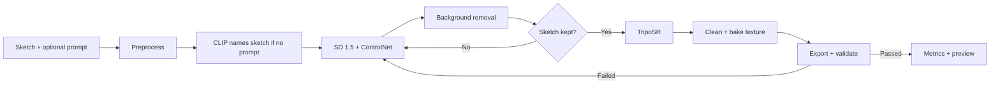

# Sketch2Shape: Project Report

TechZephyr 4.0, IIT Bhubaneswar. Computer Vision and Generative AI track.

## Problem Statement

Making a 3D asset by hand takes skills in geometry, mesh editing, texturing and professional software. A hand sketch is often the first form of an idea, but it holds limited information about depth, volume and unseen surfaces, and it may be rough or incomplete.

The challenge is one application that accepts a single sketch, drawn or uploaded, with an optional text prompt, and produces a textured 3D model. The model must be real 3D geometry, keep the sketch's main structure, and export as `.glb` or `.obj`.

## Solution Approach

Plain edge processing cannot infer a full 3D object, and a generator working alone may ignore the sketch. Sketch2Shape chains the two and then measures whether the drawing survived.

| Stage | What it does |
|---|---|
| Preprocess | Handles transparency and inverted images, removes noise, boosts contrast, then centers the ink. Rejects blank images and noise |
| Sketch understanding | With no prompt, CLIP picks a subject from a configurable list of 45 objects |
| Sketch to image | Stable Diffusion 1.5 with ControlNet Scribble follows the strokes |
| Background removal | rembg isolates the object and keeps separated real parts |
| Quality gate | Checks stroke coverage and whether the object is cut off, before the slow 3D stage |
| Image to 3D | TripoSR reconstructs a mesh |
| Mesh processing | Removes floaters and degenerate faces, decimates, fixes normals, bakes a texture |
| Export and validation | Reloads each `.glb` and `.obj`, then checks size, faces, flatness and texture |

**Key decisions**
- **Name the sketch when there is no prompt.** Without a subject, a chair sketch became a fuzzy block. With CLIP's label, the same sketch became a chair.
- **Run locally on an AMD GPU.** AMD's PyTorch build for Windows works on the RX 9070 XT. Two small adapters let TripoSR run on it: a scikit-image stand-in for a compiled library, and a key rename for its checkpoint.
- **Clean up before baking.** Decimating afterwards would destroy the texture coordinates.
- **Never report false success.** A failing stage raises a stage-named error, and failed runs are logged.
- **Show the fidelity.** A sketch match view draws the user's strokes over the model, green where they land and red where they miss, with a score.
- **Let the system compare itself.** A variants mode generates 3 models and ranks them by how well they follow the strokes. The user picks one, and its seed is locked.

## Dataset(s) Used

**No custom dataset was collected or used for training, and no model was trained or fine-tuned.** The project uses pretrained models only.

Training data of each pretrained model, as stated by its publisher:

| Model | Training data | Source |
|---|---|---|
| Stable Diffusion v1.5 | LAION-2B (en) and subsets, including laion-aesthetics v2 5+ | [Model card](https://huggingface.co/stable-diffusion-v1-5/stable-diffusion-v1-5) |
| ControlNet v1.1 Scribble | Dataset not named. Scribbles synthesized from images | [Model card](https://huggingface.co/lllyasviel/control_v11p_sd15_scribble) |
| TripoSR | Renders from a curated subset of Objaverse | [Model card](https://huggingface.co/stabilityai/TripoSR) |
| IS-Net general use (rembg) | The academic IS-Net used DIS5K. Not stated for these exact weights | [DIS repository](https://github.com/xuebinqin/DIS) |
| CLIP ViT-B/32 | See the model card; not checked in detail | [Model card](https://huggingface.co/openai/clip-vit-base-patch32) |

**Test sketches** were used for evaluation only. They are described under Evaluation Metrics.

## Model Architecture

The system is a chain of pretrained models. No new network was designed.

| Model | Role | Type | Peak VRAM |
|---|---|---|---|
| CLIP ViT-B/32 | Name the sketch, score results | Vision and text encoders | 0.61 GB |
| Stable Diffusion 1.5 | Generate the object image | Latent diffusion U-Net with VAE and text encoder | 2.68 GB, with ControlNet |
| ControlNet v1.1 Scribble | Keep generation on the strokes | Conditioning copy of the U-Net encoder | Included above |
| IS-Net | Separate the object from the background | Segmentation network, run on CPU through ONNX | CPU |
| TripoSR | Build 3D from one image | Image encoder and transformer predicting a triplane, then marching cubes | 2.35 GB |

Default settings: 25 diffusion steps, guidance 7.5, ControlNet scale 1.0, mesh grid 256, target 100,000 faces, texture 1024 px, up to 3 attempts. All are in `config.yaml`.

## Evaluation Metrics

| Metric | Measures | Why |
|---|---|---|
| Ink coverage | Share of the sketch's strokes on the generated object, with 15 px tolerance | Stays reliable on broken lines and falls when a part goes missing |
| Sketch match | Share of strokes on the mesh's front view, shown to the user | The same idea as ink coverage, measured on the final 3D result. Added after the 18-run batch, so it isn't in the table below |
| Silhouette IoU | Filled sketch against the mesh's front view | Direct shape comparison, though low on open sketches |
| CLIP sketch to views | Similarity between sketch and 8 mesh renders | Semantic match |
| CLIP view consistency | Similarity between mesh renders | Whether views look like one object |
| Geometry health | Watertightness, degenerate faces, bounding-box ratio | Mesh usability |
| Efficiency | Time and peak memory per stage | Practical cost |
| Reliability | Runs producing a validated model | Whether it works repeatedly |

**Test set: 18 consecutive runs in one process, with no restart.**

| Source | Runs |
|---|---|
| Sketches drawn by the user, without and with a prompt | 4 |
| Those two sketches altered by script: thin, thick, off-center, broken, messy | 10 |
| Drawn with mouse strokes by the AI assistant while testing the app | 2 |
| Generated by script | 2 |

## Results & Analysis

Measured on Windows 11, RX 9070 XT 16 GB, Ryzen 7 9800X3D, 14.9 GB RAM.

| Metric | Mean ± std |
|---|---|
| Runs producing a validated model | 18 of 18 |
| Ink coverage | 0.970 ± 0.065 |
| Silhouette IoU | 0.649 ± 0.193 |
| Generated image IoU | 0.662 ± 0.180 |
| CLIP sketch to views | 0.752 ± 0.030 |
| CLIP text to views | 0.262 ± 0.025 |
| CLIP view consistency | 0.920 ± 0.027 |
| Watertight | 16 of 18 |
| Degenerate face ratio | 0.000 |
| Faces | 76,093 ± 22,287 |
| Attempts per run | 1.33 ± 0.69 |
| Time per model, models cached on disk | 31.4 ± 7.5 s |
| First run after start | 48.2 s (one run) |
| Peak VRAM / RAM | 2.68 GB / 6.4 GB |

**Time by stage:** image to 3D 18.1 s, sketch to image 8.2 s, metrics 2.2 s, background removal 1.5 s, everything else under 1 s each.

**Effect of the quality gate.** In an earlier batch, a user's flower sketch lost its out-of-focus leaves during background removal. It scored 0.47 ink coverage but passed the original IoU check. With coverage as the gate, it retried and reached 0.96 with the leaves present.

**Reproducibility.** A clean install in a new folder, following the README, took about 14 minutes. It gave the same silhouette IoU (0.7923) as the original environment on the same sketch.

**Variants example.** The same table sketch with 3 seeds scored 0.91, 0.90 and 0.89 on the mesh. The top-ranked result had four separate legs, while the original seed, ranked third, had two thick slabs. This is one sketch, so it shows the feature working and not a general improvement. The sketch match view also shows which strokes were missed, here the two back legs.

**Validation checks** rejected a flat plane, a too-small mesh, a lost texture, a corrupt file and an empty mesh. Forced failures confirmed that a retry recovers and that repeated failure raises an error.

**Sample outputs** with their inputs and metrics are in [examples/](examples/).

**Limits of these results**
- Only 2 distinct user sketches are in the set, so this is not a general accuracy claim.
- The 0.7 coverage threshold was chosen on sketches that are also in this test set.
- Metrics miss some visible faults. A table's four legs became two thick slabs and still scored 1.00 ink coverage.
- Hidden geometry is a guess, and side views are often thin or skewed.
- Stray marks can become part of the object, and a prompt can change the view: "a red sports car" turned a side-view sketch front-on.
- Only one AMD GPU was tested end to end. A CPU run was stopped during image generation at about 44 s per step, and the Colab path has not been run.
- No second 3D model is set up. The fallback code path is tested, but no fallback is configured.

## Real-World Application

| Field | Use |
|---|---|
| Product design and prototyping | Turn a concept sketch into a 3D model to review from all sides in about 30 seconds |
| Architecture and interiors | Quick massing and furniture ideas from a rough drawing |
| Animation, VFX and games | Starting assets to refine in 3D software |
| Education | Let students see a drawing as a 3D form without learning modeling software |
| 3D printing | Early shape exploration. Not manufacturing-ready geometry |

Output is a starting point to inspect and refine, not a finished production asset. Generated results should be reviewed before use, and each pretrained model's license applies; see [ATTRIBUTION.md](ATTRIBUTION.md).
